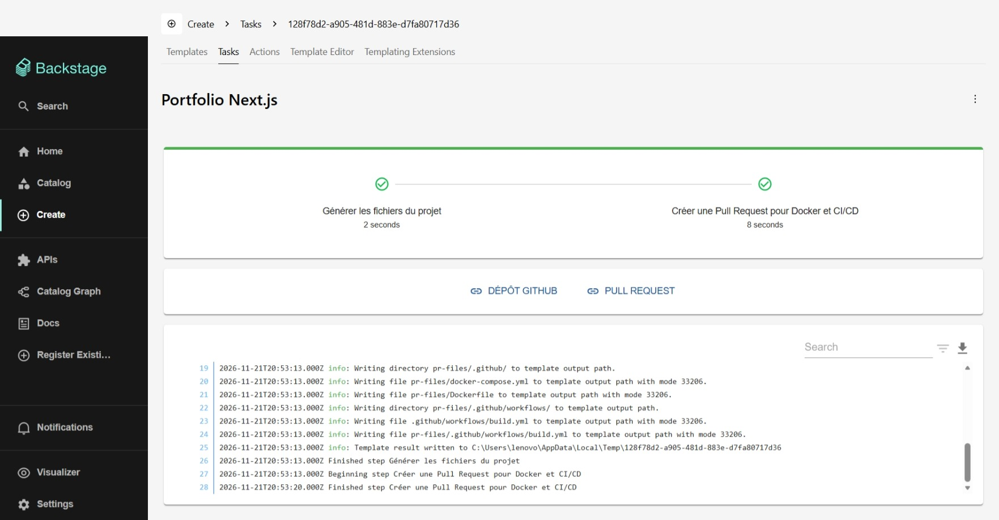
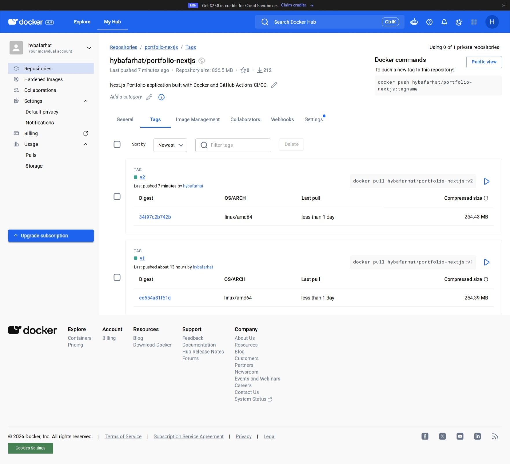
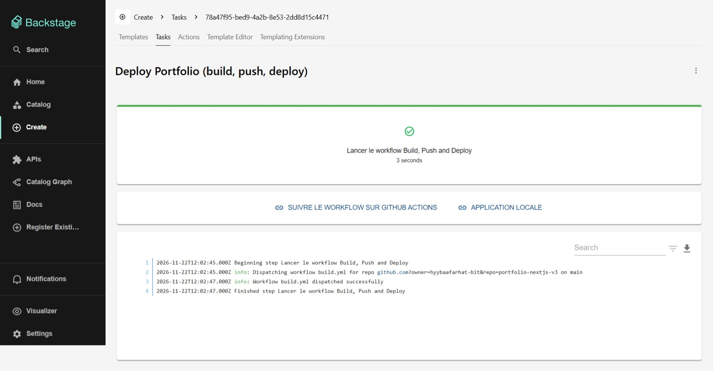
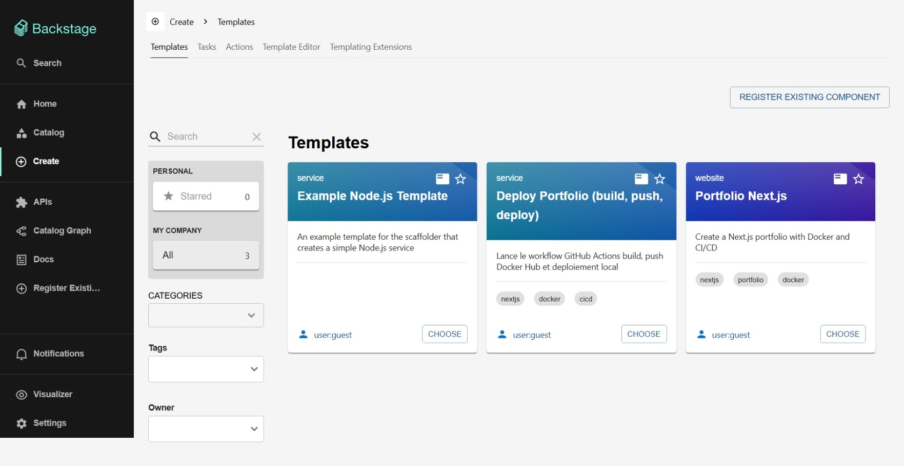

# Portfolio Next.js - Industrialisation avec Backstage

Activité pratique : Platform Engineering avec Backstage (formateur : Wahid Hamdi).
Ce dépôt contient le portfolio de Hyba Farhat (Next.js) et toute la chaîne de livraison
automatisée : Backstage, GitHub Actions, Docker Hub et déploiement local.

## 1. Architecture

```
Backstage (http://localhost:3002)
   |  template "Deploy Portfolio" (action github:actions:dispatch, input: version)
   v
GitHub Actions - workflow "Build, Push and Deploy" (.github/workflows/build.yml)
   |-- job build  (ubuntu-latest) : build de l'image Docker + push sur Docker Hub
   |-- job deploy (runner self-hosted sur le poste local) : docker compose up -d + health check
   v
Application accessible sur http://localhost:3000
```

| Composant | Rôle |
|---|---|
| Next.js 15.5.29 | Application portfolio |
| Dockerfile / docker-compose.yml | Conteneurisation et déploiement |
| GitHub Actions | Build, push et déploiement automatiques |
| Docker Hub | Registre des images `hybafarhat/portfolio-nextjs:<version>` |
| Runner self-hosted | Exécute le déploiement sur la machine locale |
| Backstage | Portail développeur : création du projet et déclenchement du workflow |

## 2. Contenu du dépôt

| Fichier | Description |
|---|---|
| `app/page.js`, `app/layout.js` | Pages du portfolio (sections, mode sombre) |
| `Dockerfile` | Image Node 20 Alpine : `npm ci`, `npm run build`, `npm start` sur le port 3000 |
| `.dockerignore` | Exclut `node_modules`, `.next`, etc. |
| `docker-compose.yml` | Service `portfolio-nextjs`, image `hybafarhat/portfolio-nextjs:${VERSION:-v1}`, port `3000:3000`, healthcheck |
| `.github/workflows/build.yml` | Workflow `workflow_dispatch` avec l'entrée `version` |
| `catalog-info.yaml` | Composant du catalogue Backstage (annotation `github.com/project-slug`) |
| `next.config.js` | Configuration Next.js (`outputFileTracingRoot`, ESLint ignoré au build) |

## 3. Templates Backstage

Deux templates sont enregistrés dans `app-config.yaml` (section `catalog.locations`) :

1. **`portfolio-nextjs-template`** (étapes 1 à 3) : génère le projet Next.js, les fichiers
   Docker, le workflow et `catalog-info.yaml`, puis ouvre une Pull Request sur GitHub.
2. **`portfolio-deploy-template`** (étapes 4 à 7) : lance le workflow GitHub Actions avec la
   version choisie (`v1`, `v2`, `v1.1`...).

Backstage s'exécute sur `http://localhost:3002` afin de laisser le port `3000` au portfolio.
(`app.baseUrl` et `backend.cors.origin` sont réglés sur `3002` dans `app-config.yaml`.)

## 4. Pipeline de livraison

Le workflow `Build, Push and Deploy` s'exécute à la demande avec la version choisie :

1. **build** : récupération du code, connexion à Docker Hub, construction et push de l'image
   `hybafarhat/portfolio-nextjs:<version>`.
2. **deploy** (runner self-hosted) : récupération du code, `docker compose down`,
   `docker compose pull`, `docker compose up -d`.
3. **Vérification de santé** : requêtes sur `http://localhost:3000` (12 tentatives, 5 s d'intervalle).

Les photos et le CV (`hyba.jpg`, `CV_Hyba_Farhat.pdf`) ne sont pas versionnés dans Git.
Ils sont montés dans le conteneur depuis un dossier local défini par la variable `ASSETS_DIR`
(par défaut `./public`, et `C:/portfolio-assets` sur le runner).

## 5. Configuration nécessaire

**Secrets GitHub** (Settings > Secrets and variables > Actions) :

| Secret | Valeur |
|---|---|
| `DOCKERHUB_USERNAME` | Nom d'utilisateur Docker Hub |
| `DOCKERHUB_TOKEN` | Jeton d'accès Docker Hub (lecture/écriture) |

**Runner self-hosted** : installé dans `C:\actions-runner`, lancé avec `.\run.cmd`
(Docker Desktop doit être démarré). Sous Windows, la politique d'exécution PowerShell doit
autoriser les scripts : `Set-ExecutionPolicy -Scope CurrentUser -ExecutionPolicy RemoteSigned`.

**Backstage** : la variable d'environnement `GITHUB_TOKEN` (jeton fine-grained limité au dépôt,
permissions Actions, Contents et Pull requests en lecture/écriture) doit être définie dans le
terminal qui lance `yarn start`. Ne jamais écrire ce jeton dans un fichier versionné.

## 6. Démonstration

1. Ouvrir `http://localhost:3002/create` et choisir **Deploy Portfolio (build, push, deploy)**.
2. Saisir la version (par exemple `v1`), puis **Review** et **Create**.
3. Suivre le workflow sur GitHub Actions (jobs `build` puis `deploy`).
4. Vérifier le déploiement :
   ```
   docker ps
   ```
   Le conteneur `portfolio-nextjs` doit être `healthy` sur `0.0.0.0:3000->3000/tcp`.
5. Ouvrir `http://localhost:3000`.

## 7. Évolution du portfolio (étape 7)

Après le premier déploiement (`v1`), les évolutions suivantes ont été ajoutées dans `app/page.js` :

- section **Certifications** ;
- section **Projets DevOps & Cloud** ;
- **mode sombre** (bouton dans le menu, préférence mémorisée) ;
- mise à jour des informations personnelles.

Le code a été fusionné dans `main` par Pull Request (la branche est protégée), puis le
template **Deploy Portfolio** a été relancé depuis Backstage avec la version **`v2`**.
Le workflow a reconstruit l'application, publié `hybafarhat/portfolio-nextjs:v2` sur
Docker Hub, remplacé le conteneur local et validé la santé du service.

```
Modification du code -> Build -> Image Docker -> Docker Hub -> Déploiement local -> Validation
```

## 8. Sécurité et dépendances

- Next.js a été mis à jour de 14.2.15 vers **15.5.29** pour corriger les vulnérabilités signalées par `npm audit`.
- Reste une alerte sur `postcss` (dépendance interne de Next.js), sans impact pour un site statique.
- Jetons GitHub et Docker Hub : jamais dans le code, uniquement dans les secrets ou les variables d'environnement. Les supprimer après la démonstration.
- Un runner self-hosted sur un dépôt public est déconseillé : exiger une approbation pour les pull requests externes ou passer le dépôt en privé.

## 9. Dépannage

| Problème | Cause et solution |
|---|---|
| `port is already allocated` | Un conteneur utilise déjà le port 3000 : `docker ps`, puis `docker stop <nom>` |
| Step `deploy` : exécution de scripts désactivée | Politique PowerShell : voir section 5 |
| `No token available for host: github.com` (Backstage) | `GITHUB_TOKEN` absent du terminal qui lance Backstage |
| `Bad credentials` | Jeton expiré ou mal copié : en générer un nouveau |
| `A session for this runner already exists` | Ancienne session du runner : attendre quelques minutes ou fermer le second terminal |
| Push refusé sur `main` | Branche protégée : passer par une Pull Request |

## 10. Captures d'écran

### Templates enregistrés dans Backstage

Le catalogue de Backstage (`/create`) affiche les deux templates du projet : **Portfolio Next.js**
(création du projet) et **Deploy Portfolio (build, push, deploy)** (déploiement).



### Étapes 1 à 3 : création du projet depuis Backstage

Le template **Portfolio Next.js** génère les fichiers du projet (Dockerfile, `docker-compose.yml`,
workflow GitHub Actions) puis crée automatiquement une Pull Request sur GitHub.



### Étapes 4 à 7 : déclenchement du workflow depuis Backstage

Le template **Deploy Portfolio** lance le workflow `build.yml` sur GitHub Actions. Le journal
indique `Workflow build.yml dispatched successfully`, et la page propose les liens vers GitHub
Actions et vers l'application locale.



### Étape 5 : images publiées sur Docker Hub

Le dépôt `hybafarhat/portfolio-nextjs` contient les deux versions produites par le pipeline :
`v1` (premier déploiement) et `v2` (après l'évolution du portfolio).



## 11. Livrables

1. Templates Backstage : `portfolio-nextjs-template` et `portfolio-deploy-template`
2. Dépôt Git : `https://github.com/hyybaafarhat-bit/portfolio-nextjs-v3`
3. Application Portfolio Next.js
4. `Dockerfile`
5. `docker-compose.yml`
6. Images publiées sur Docker Hub : `hybafarhat/portfolio-nextjs:v1` et `:v2`
7. Documentation technique : ce fichier
8. Démonstration du workflow Backstage
9. Démonstration de l'évolution du projet et de la réexécution du pipeline
